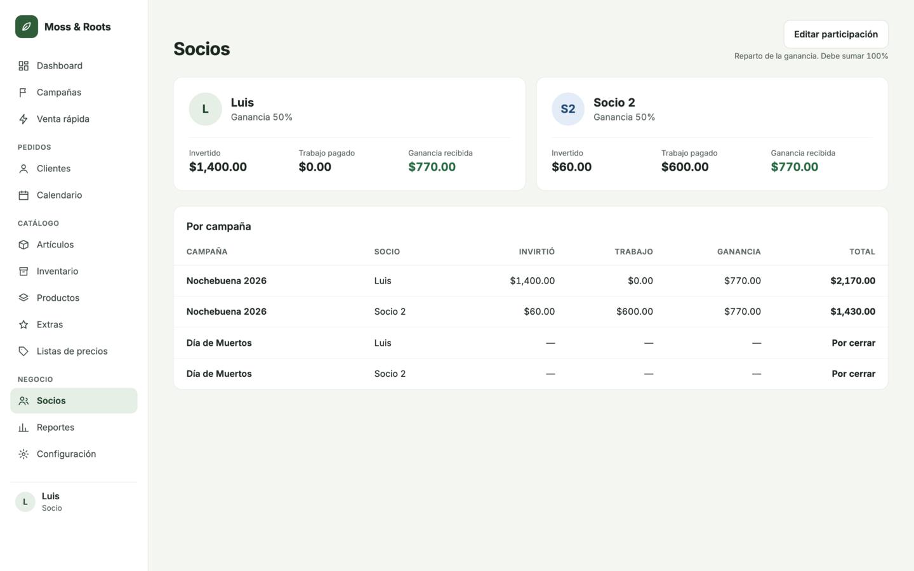
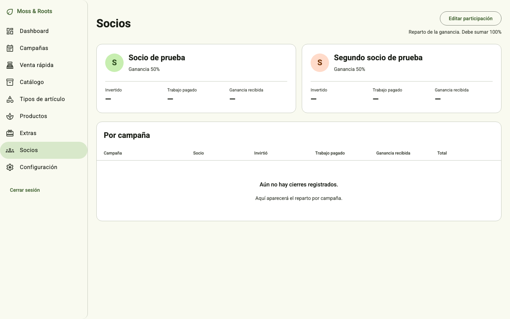
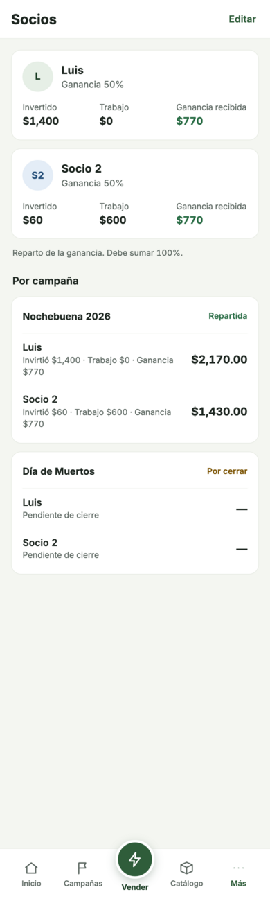
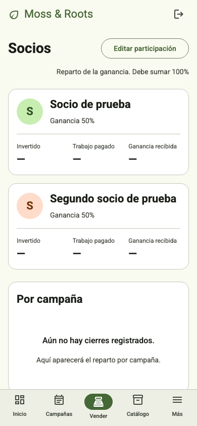
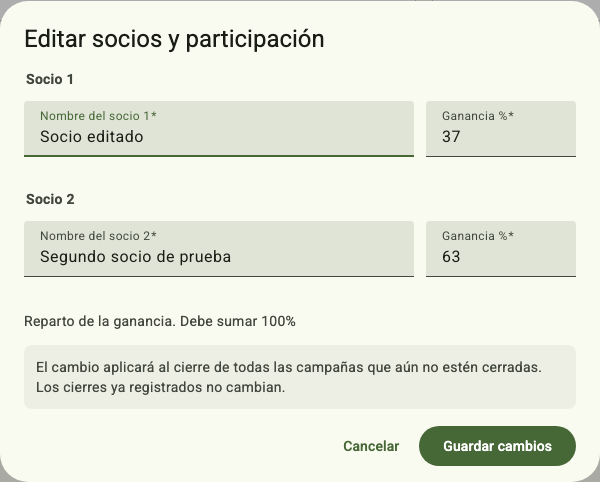
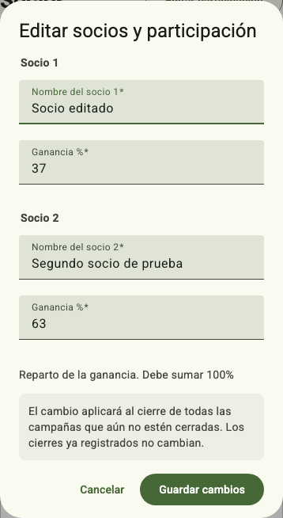

# S1 · Revisión visual de Socios

Capturas reales de Playwright a 1440 y 390 píxeles CSS, exportadas a escala CSS (1×), después de verificar edición, validación y conflicto de versiones. Los nombres corresponden a las dos cuentas de prueba; las participaciones iniciales provienen del valor por defecto de la especificación. No se cargaron cifras de las imágenes de referencia.

## Desktop · 1440 px

| Referencia | Implementación |
| --- | --- |
|  |  |

## Mobile · 390 px

| Referencia | Implementación |
| --- | --- |
|  |  |

## Editor

| Desktop | Mobile |
| --- | --- |
|  |  |

## Diferencias justificadas

- Las imágenes muestran campañas e importes ilustrativos. S1 muestra montos sin datos y el estado vacío «Aún no hay cierres registrados», conforme al alcance aprobado hasta que K7 provea snapshots. No hay semillas ni tablas de cierres.
- «Trabajo pagado» es explícito también en móvil y en la cabecera de la lista. La especificación (§7, pantalla 22) distingue devengado, pagado e impago; K7 proporcionará ese desglose, además del resultado y del total, sin recalcular históricos.
- Se conservan la composición de tarjetas, la jerarquía y las etiquetas solicitadas. Se usan los tokens Material y la navegación MVP existentes; la referencia muestra navegación objetivo con pantallas de fase 2.
- El editor incluye nombres, porcentajes enteros y el aviso aprobado de aplicación a cierres futuros. K1 añadirá el listado de campañas no cerradas afectadas; S1 no depende de esa lista.

Verificación: sin desborde horizontal a ambos anchos; edición persistida tras recargar; rechazo de decimales y suma distinta de 100%; captura conservada al recibir 409; restauración de nombres y participaciones en `afterEach`, sin borrar socios.
